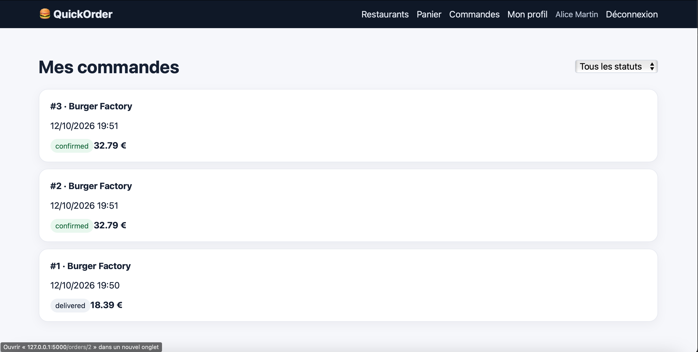

# BUG-01 – Un paiement PayPal crée deux commandes

| | |
|---|---|
| **Sévérité** | Critique |
| **Priorité** | P1 |
| **Cas de test** | TC-R05 |

## Contexte

Quand un client paie avec PayPal, QuickOrder enregistre deux commandes identiques au lieu d'une. Le client est facturé deux fois pour un seul panier et le restaurant reçoit deux fois la même commande.

## Préconditions

- Base remise à zéro (`python seed.py`)
- Compte d'Alice connecté (alice@example.com / Password123!)
- Panier avec 2 × Double Cheese (Burger Factory), total 32,79€

## Étapes

1. Ouvrir "Commandes": seule la commande de démonstration #1 est présente
2. Ouvrir le panier et cliquer sur "Passer commande"
3. Choisir "PayPal" comme mode de paiement
4. Cliquer une seule fois sur "Confirmer"
5. Revenir sur "Commandes"

## Résultat attendu

Une seule nouvelle commande de 32,79€.

## Résultat obtenu

Deux nouvelles commandes apparaissent: #2 et #3, créées à la même minute (19:51), toutes les deux à 32,79 € et au statut "confirmed".

## Preuve

