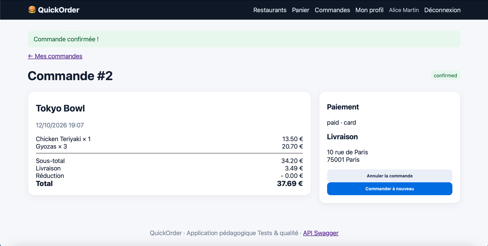
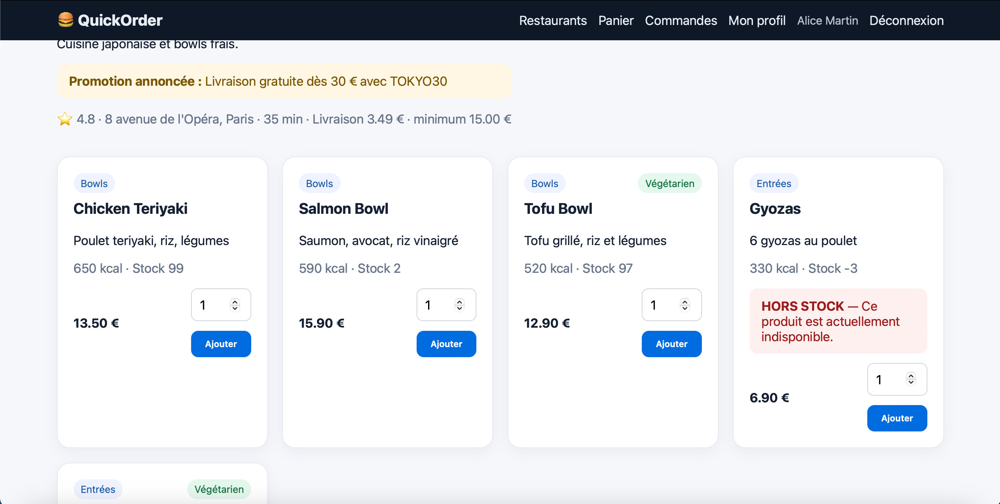
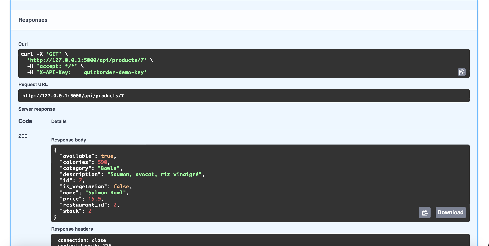
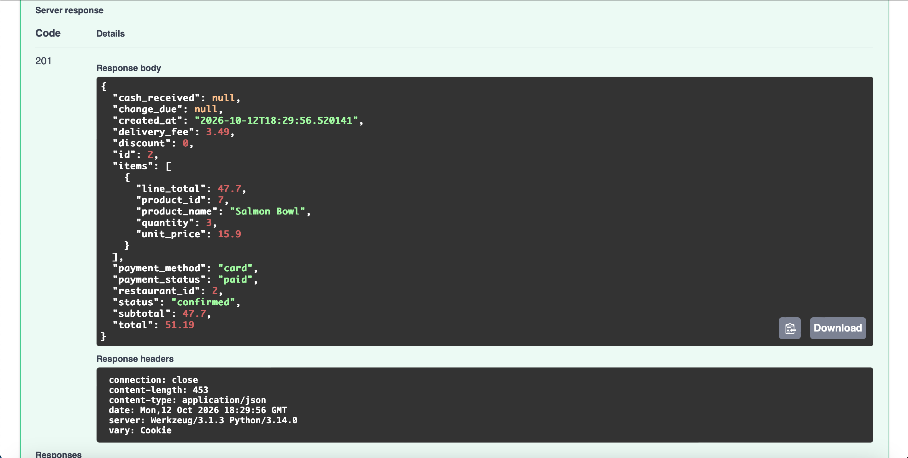
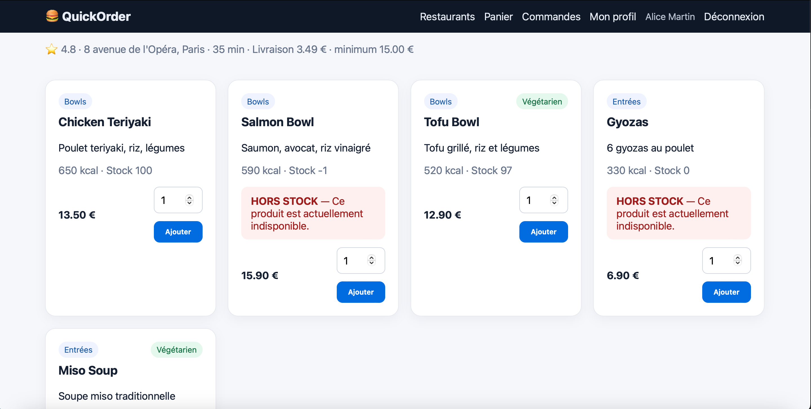

# BUG-02 – Le stock n'est pas vérifié à la commande

| | |
|---|---|
| **Sévérité** | Critique |
| **Priorité** | P1 |
| **Cas de test** | TC-L03, TC-E02 |

## Contexte

QuickOrder affiche le stock de chaque plat et marque "HORS STOCK" les plats épuisés. Pourtant, on peut quand même les commander et on peut commander plus que la quantité disponible. Le stock devient alors négatif. Le restaurant reçoit des commandes qu'il ne peut pas préparer.

Le problème existe à la fois sur le site et dans l'API.

## Préconditions

- Base remise à zéro (`python seed.py`)
- Gyozas (Tokyo Bowl): stock 0, affichés "HORS STOCK"
- Salmon Bowl (Tokyo Bowl): stock 2
- Pour l'API: Swagger ouvert avec la clé `quickorder-demo-key`

## Étapes

**Sur le site (TC-E02)**
1. Se connecter avec Alice
2. Ouvrir le menu de Tokyo Bowl
3. Ajouter 3 Gyozas, puis 1 Chicken Teriyaki
4. Payer par carte
5. Revenir sur le menu de Tokyo Bowl et regarder le stock des Gyozas

**Avec l'API (TC-L03)**
1. `GET /products/7`: le stock du Salmon Bowl est de 2
2. `POST /orders` avec `{"items":[{"product_id":7,"quantity":3}],"payment_method":"card"}`

## Résultat attendu

- Sur le site: message d'erreur, les Gyozas n'entrent pas dans le panier.
- Avec l'API: commande refusée (code 409, "Produit indisponible" d'après la doc Swagger).

## Résultat obtenu

- Sur le site: la commande #2 est confirmée avec Gyozas × 3 (total 37,69 €). Sur le menu, les Gyozas affichent maintenant **Stock -3**, toujours avec le message "HORS STOCK".
- Avec l'API: la commande de 3 Salmon Bowl est créée (code 201) alors qu'il n'en restait que 2.

## Preuve

Sur le site:

Avec l'API:

