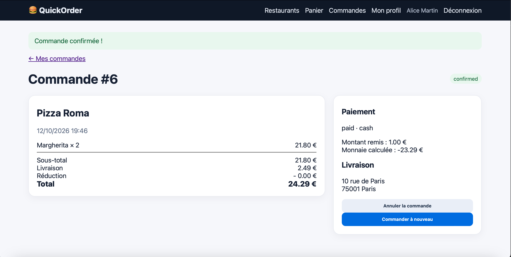

# BUG-03 – Paiement en espèces accepté avec un montant insuffisant

| | |
|---|---|
| **Sévérité** | Majeur |
| **Priorité** | P1 |
| **Cas de test** | TC-R04 |

## Contexte

Avec le paiement en espèces, le client indique combien il va donner au livreur pour que la monnaie soit calculée. QuickOrder ne vérifie pas que ce montant couvre le total: une commande de 24,29 € passe avec 1 € et s'affiche comme payée.

## Préconditions

- Base remise à zéro
- Compte d'Alice connecté
- Panier avec 2 × Margherita (Pizza Roma), total 24,29€

## Étapes

1. Ouvrir la page de paiement
2. Choisir "Espèces"
3. Saisir 1 dans "Montant remis en espèces"
4. Cliquer sur "Confirmer"

## Résultat attendu

Commande refusée avec un message du type "Le montant remis doit être au moins égal au total".

## Résultat obtenu

La commande #6 est confirmée avec le paiement "paid · cash". La page affiche "Montant remis: 1.00€" et "Monnaie calculée: -23.29€". Une monnaie négative n'a pas de sens.

## Preuve

