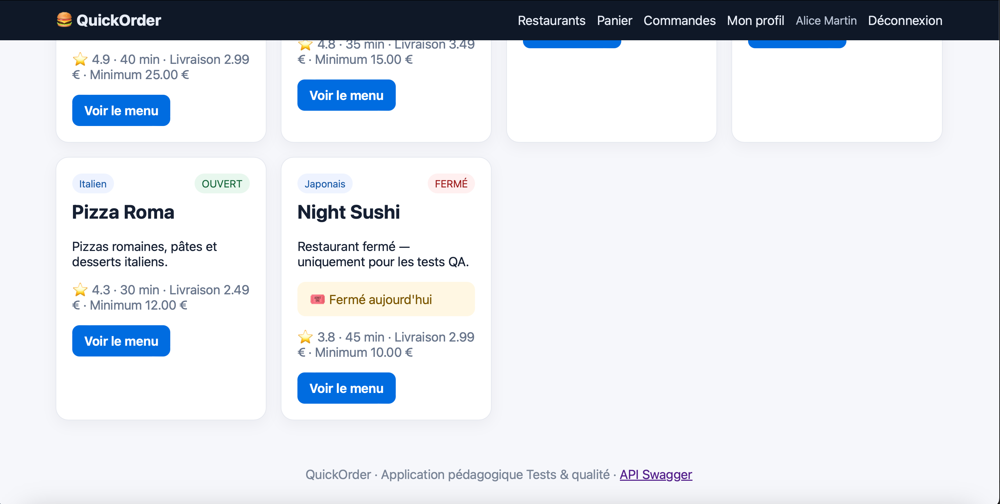
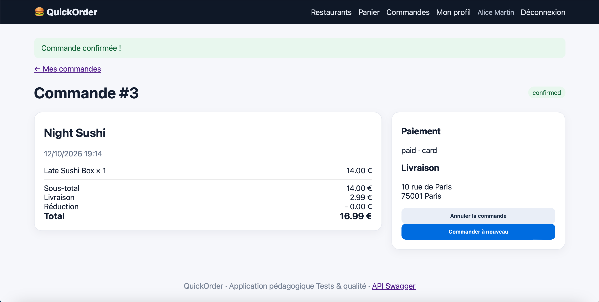

# BUG-04 – Un restaurant fermé accepte les commandes

| | |
|---|---|
| **Sévérité** | Majeur |
| **Priorité** | P1 |
| **Cas de test** | TC-E03 |

## Contexte

Le restaurant Night Sushi est affiché avec le badge "FERMÉ". On peut pourtant ajouter ses plats au panier et valider la commande. Personne ne pourra la préparer.

## Préconditions

- Base remise à zéro
- Compte d'Alice connecté, panier vide
- Night Sushi affiché "FERMÉ"

## Étapes

1. Ouvrir le menu de Night Sushi
2. Ajouter 1 Late Sushi Box (14,00€)
3. Ouvrir la page de paiement et choisir "Carte bancaire"
4. Cliquer sur "Confirmer"

## Résultat attendu

Ajout ou commande refusé avec un message "Ce restaurant est fermé".

## Résultat obtenu

La commande #3 est créée au statut "confirmed" et payée par carte, pour 16,99€.

## Preuve

