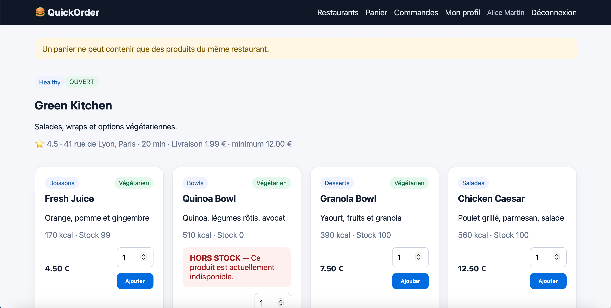
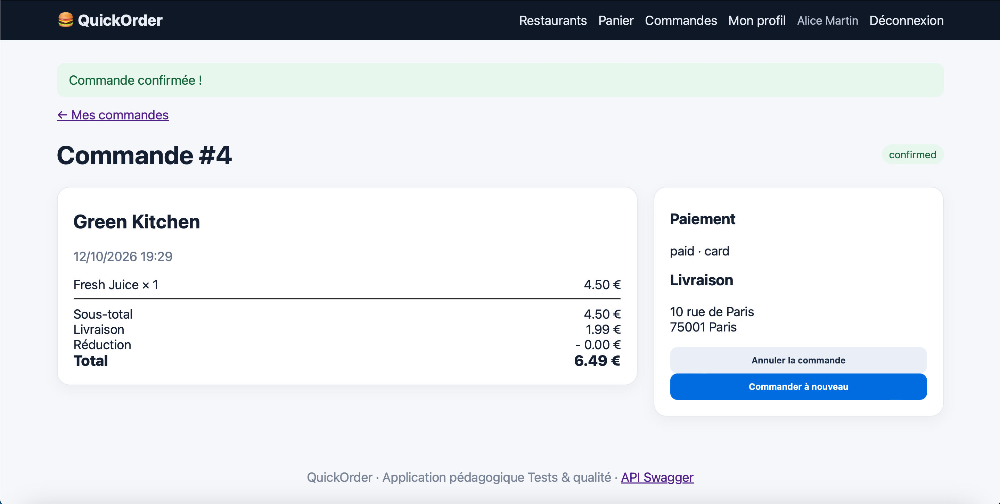
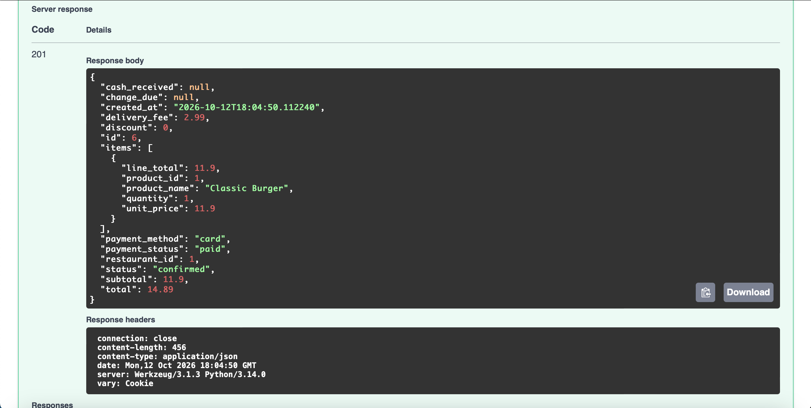

# BUG-05 – Le minimum de commande n'est pas appliqué

| | |
|---|---|
| **Sévérité** | Majeur |
| **Priorité** | P1 |
| **Cas de test** | TC-R01 |

## Contexte

Chaque restaurant a un minimum de commande, affiché sur sa page et sur la page de paiement. Ce minimum n'est jamais vérifié, ni sur le site ni dans l'API: on peut commander pour moins.

## Préconditions

- Base remise à zéro
- Compte d'Alice connecté, panier vide
- Green Kitchen: minimum de commande 12,00€

## Étapes

1. Ouvrir le menu de Green Kitchen ("minimum 12.00€" est affiché)
2. Ajouter 1 Fresh Juice (4,50€)
3. Ouvrir la page de paiement
4. Cliquer sur "Confirmer"

## Résultat attendu

Commande refusée avec un message indiquant que le minimum de 12,00€ n'est pas atteint.

## Résultat obtenu

La commande #4 est confirmée avec un sous-total de 4,50€ (total 6,49€).

Le même problème existe dans l'API: pendant TC-L01, une commande d'un seul Classic Burger (11,90€) a été acceptée chez Burger Factory, dont le minimum est de 20€.

## Preuve

