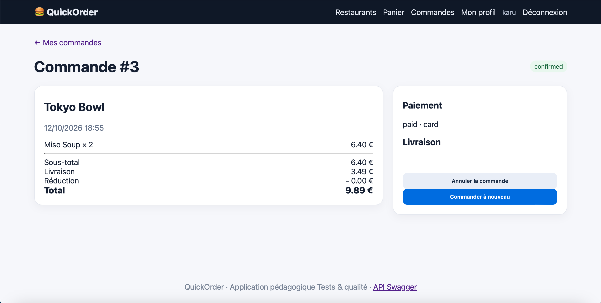

# BUG-06 – Un nouveau client peut commander sans adresse

| | |
|---|---|
| **Sévérité** | Majeur |
| **Priorité** | P2 |
| **Cas de test** | TC-E01 |

## Contexte

À l'inscription, QuickOrder crée automatiquement une adresse "Domicile" vide. Au moment de payer, cette adresse vide est proposée par défaut et la commande passe. Le livreur ne sait pas où livrer.

## Préconditions

- Être déconnecté
- Utiliser un email jamais utilisé

## Étapes

1. Créer un compte (nom, email, mot de passe de 8 caractères)
2. Ouvrir Tokyo Bowl et ajouter 2 × Miso Soup
3. Ouvrir la page de paiement: le champ "Adresse" affiche "Domicile — ,"
4. Cliquer sur "Confirmer"

## Résultat attendu

Le site demande de saisir une adresse complète avant de pouvoir valider.

## Résultat obtenu

La commande #3 est confirmée et payée par carte (9,89 €). Dans le détail de la commande, la partie "Livraison" est vide: aucune rue, aucun code postal, aucune ville.

Remarque: cette commande est aussi sous le minimum de Tokyo Bowl (15€), ce qui confirme BUG-05.

## Preuve

