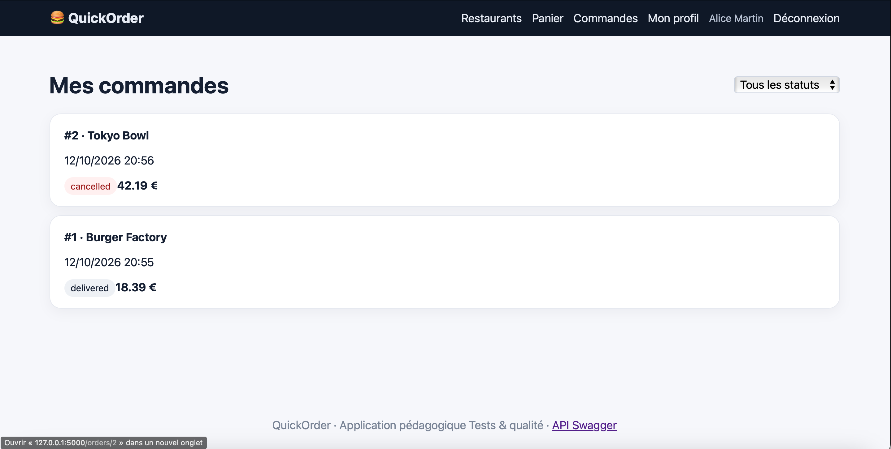

# BUG-07 – Annuler une commande ne remet pas le stock

| | |
|---|---|
| **Sévérité** | Majeur |
| **Priorité** | P2 |
| **Cas de test** | TC-R02 |

## Contexte

Un client peut annuler une commande confirmée. La commande passe bien en "cancelled" mais les plats ne sont pas rendus au stock. À chaque annulation le stock affiché devient plus faible que la réalité.

## Préconditions

- Base remise à zéro (`python seed.py`)
- Compte d'Alice connecté
- Tofu Bowl (Tokyo Bowl): stock 100

## Étapes

1. Ouvrir Tokyo Bowl et noter le stock du Tofu Bowl (100)
2. Commander 3 Tofu Bowl, paiement par carte
3. Sur la page de la commande, cliquer sur "Annuler la commande"
4. Revenir sur le menu de Tokyo Bowl

## Résultat attendu

Statut "cancelled" et stock du Tofu Bowl revenu à 100.

## Résultat obtenu

La commande #2 (42,19€) passe bien en "cancelled" mais le Tofu Bowl affiche toujours **Stock 97** sur le menu.

## Preuve

