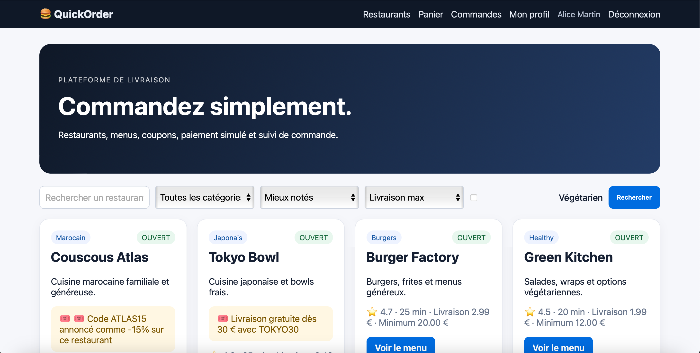
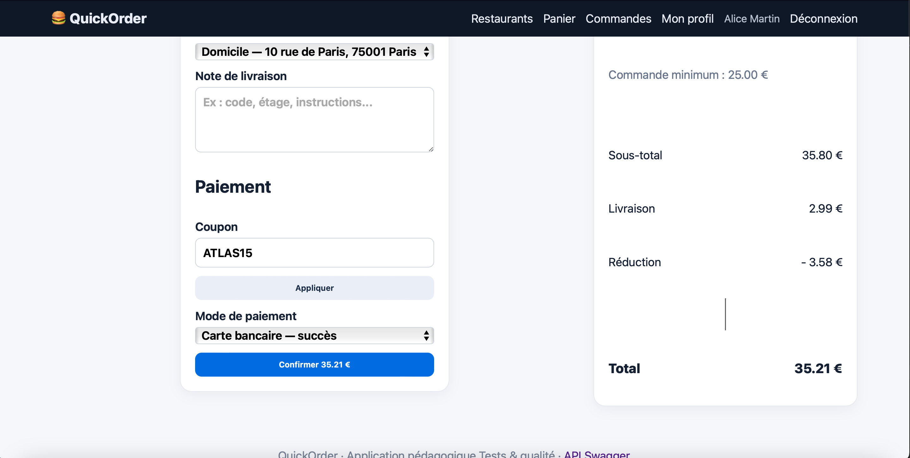

# BUG-08 – La promo ATLAS15 applique 10 % au lieu de 15 %

| | |
|---|---|
| **Sévérité** | Majeur |
| **Priorité** | P2 |
| **Cas de test** | TC-R06 |

## Contexte

La page d'accueil annonce "Code ATLAS15 annoncé comme -15% sur ce restaurant" pour Couscous Atlas. Le code ne donne en réalité que 10 %. Le client paie plus que ce qu'on lui a promis, ce qui peut être considéré comme de la publicité trompeuse.

## Préconditions

- Base remise à zéro
- Compte d'Alice connecté, panier vide

## Étapes

1. Sur la page d'accueil, lire la promotion de Couscous Atlas (-15 %)
2. Ajouter 2 × Couscous Royal (35,80€)
3. Ouvrir la page de paiement
4. Saisir ATLAS15 dans "Coupon" et cliquer sur "Appliquer"

## Résultat attendu

Réduction de 15 %, soit 5,37€. Total: 33,42 €.

## Résultat obtenu

Réduction de 3,58€ (10 %). Total: 35,21€.

## Preuve

